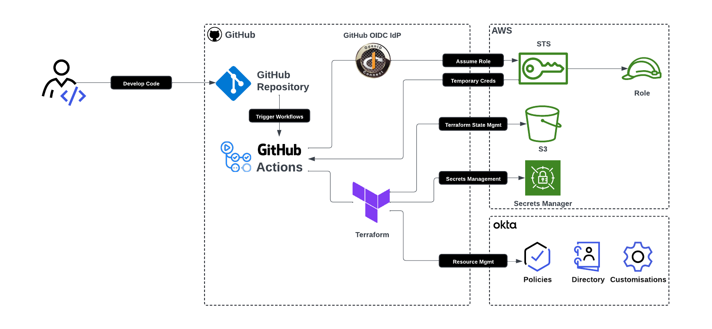
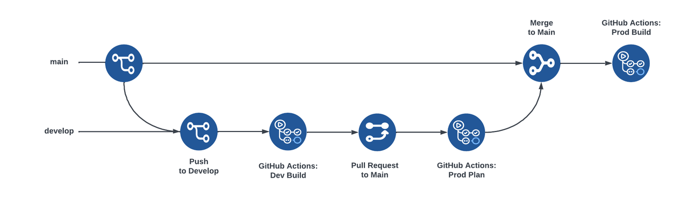

# Okta Terraform CI/CD Lab

Managing Okta configuration as code with Terraform, deployed through GitHub Actions to AWS, with **no long-lived credentials** stored in GitHub.

Built by following Okta's [How to Create a Secure CI/CD Pipeline Using Okta Terraform][blog] and adapting it to my own Okta, AWS and GitHub environment.



## What this lab demonstrates

- **Keyless CI/CD auth:** GitHub Actions gets short-lived AWS credentials through **OIDC federation** (`AssumeRoleWithWebIdentity`). There are no AWS access keys in the repo or in GitHub secrets.
- **Okta OAuth 2.0 service app:** Terraform authenticates to the Okta Management API with the **client credentials flow and `private_key_jwt`**. The private key lives only in **AWS Secrets Manager** and is read at plan/apply time.
- **Least privilege at every layer:**
  - The IAM role trust policy is limited to this repo's `develop`, `main` and pull request refs.
  - The IAM permissions cover only the state bucket, the lock table and one secret.
  - The Okta app is granted only the `okta.groups.manage` scope.
- **Remote state with locking:** S3 backend with a DynamoDB lock table, separate state keys for dev and prod.
- **GitOps promotion flow:** push to `develop` → apply to dev; PR to `main` → plan for prod; merge → apply to prod.
- **No environment identifiers in source:** the Okta org, client ID and key ID are injected as `TF_VAR_*` from GitHub Actions secrets, so they are masked in public logs.
- **Automated security scanning:**
  - **CodeQL** scans the GitHub Actions workflows.
  - **Checkov** scans the Terraform and the workflows for misconfigurations.
  - Both report into GitHub's Code scanning tab.
  - Third-party actions are pinned to commit SHAs.



## Repository layout

```
.github/workflows/
  push-develop.yml   # Dev Build: plan + apply on push to develop
  pr-main.yml        # Prod Plan: plan only on PRs into main
  push-main.yml      # Prod Build: plan + apply on push to main
  checkov.yml        # Checkov IaC scan → SARIF → Code scanning
terraform/
  main.tf            # providers, S3 backend, Secrets Manager lookup
  variables.tf
  vars-dev.tfvars / vars-prod.tfvars
  backend-dev.conf / backend-prod.conf
  modules/directory/ # Okta resources (okta_group)
iam-policy.json        # IAM permissions policy for the GitHub Actions role
iam-trust-policy.json  # OIDC trust policy for the GitHub Actions role
```

## Setup

### Okta
1. Create an **API Services** app with **Public key / Private key** client authentication. Let Okta generate the key pair and save the private key (PKCS#8 PEM).
2. Turn off **Require DPoP** for the app. Provider v4.10 doesn't send DPoP proofs.
3. Under **Okta API Scopes**, grant `okta.groups.manage`.
4. Under **Admin roles**, assign a role that can create groups.

### AWS
1. Create the S3 state bucket and the DynamoDB lock table (partition key `LockID`).
2. Store the Okta private key in Secrets Manager as **plaintext** (the raw PEM, not key/value JSON).
3. Add the GitHub OIDC identity provider (`token.actions.githubusercontent.com`).
4. Create an IAM role for GitHub Actions, filling in the placeholders in both files:
   - [iam-trust-policy.json](iam-trust-policy.json): who can assume the role (this repo's `develop`, `main` and pull request workflows, via OIDC).
   - [iam-policy.json](iam-policy.json): what Terraform can do with the role. It can read and write state in S3, take the state lock in DynamoDB, and read the Okta private key from Secrets Manager.

### GitHub Actions secrets and variables
Settings → Secrets and variables → Actions.

These four identifiers aren't credentials. They're stored as **Secrets** so GitHub masks them in public workflow logs:

| Secret | Example |
|---|---|
| `AWS_ROLE_ARN` | `arn:aws:iam::<account>:role/<role>` |
| `OKTA_ORG_NAME` | `dev-123456` (subdomain only) |
| `OKTA_CLIENT_ID` | the API Services app's client ID |
| `OKTA_PRIVATE_KEY_ID` | the KID shown for the app's public key |

| Variable | Example |
|---|---|
| `AWS_REGION` | `us-west-2` |

## Troubleshooting notes

Problems I hit while building this, and their fixes:

| Symptom | Cause | Fix |
|---|---|---|
| `okta_group` stuck on "Still creating..." for minutes | `base_url` was set to the full host. The provider builds `https://<org_name>.<base_url>`, so it called `org.org.okta.com` and kept retrying. | `okta_base_url = "okta.com"` and `okta_org_name` = subdomain only. |
| `Error acquiring the state lock` / `ConditionalCheckFailedException` | A cancelled run left its lock in DynamoDB. | Confirm no run is active, then `terraform force-unlock <ID>`. Added `concurrency` and `timeout-minutes` to the workflows. |
| `failed to create group: empty access token` | Okta rejected the token request. The provider hides the reason, which was DPoP being required by default on new service apps. | Disable DPoP on the app; verify the KID, key and granted scopes. |
| `You do not have permission to perform the requested action` | The token was valid, but the app had no admin role. Scopes and admin roles are checked separately. | Assign an admin role that can create groups. |
| AWS `AssumeRoleWithWebIdentity` denied | The repo's OIDC `sub` claim uses the ID-based format (`repo:owner@id/repo@id:...`). | Match the trust policy `sub` to the actual claim. |
| Private key failed to parse | The key was in OpenSSH format. | Use the Okta-generated PKCS#8 key. |

## Credits

Based on [oktadev/okta-terraform-devops-template-example](https://github.com/oktadev/okta-terraform-devops-template-example) by Okta, licensed under Apache 2.0. See [LICENSE](LICENSE).

[blog]: https://developer.okta.com/blog/2024/10/11/terraform-ci-cd
